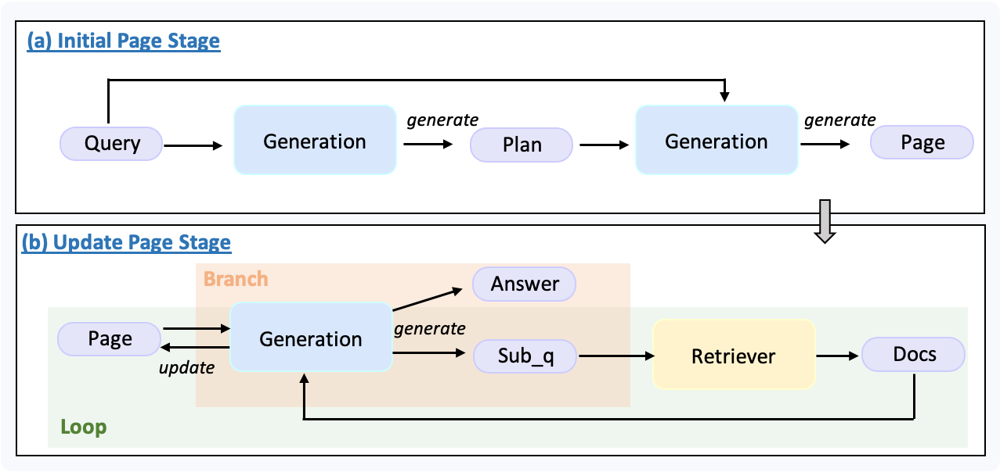
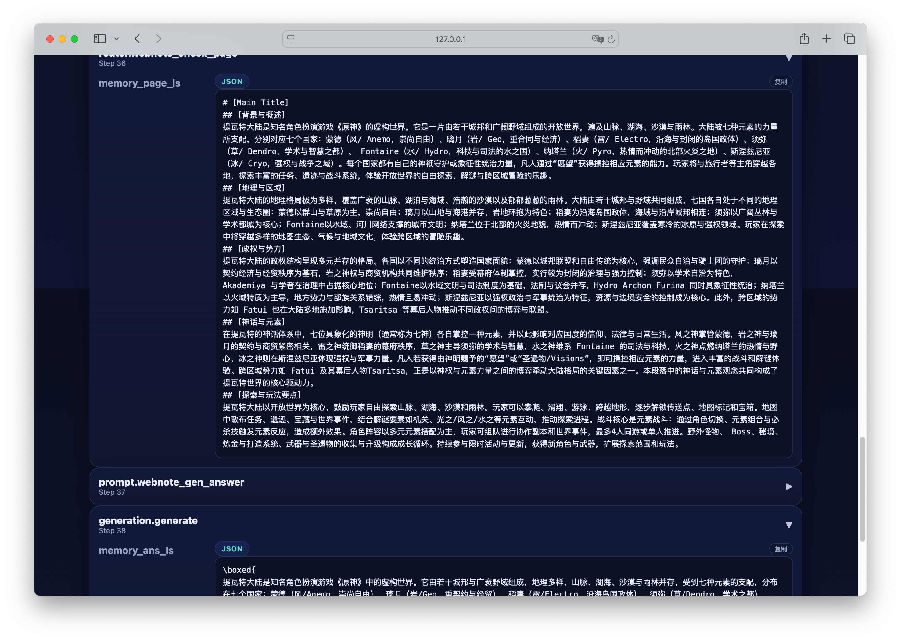

<Note>我们为该 Demo 录制了一期讲解视频：[📺 bilibili](https://www.bilibili.com/video/BV1p8JfziEwM/?spm_id_from=333.337.search-card.all.click)。</Note>

## 什么是DeepResearch

Deep Research（也称为 Agentic Deep Research）是指大语言模型（LLM）协同工具（如搜索、浏览器、代码执行、记忆存储等），以“多轮推理→检索→验证→融合”的闭环方式，完成复杂任务的研究型智能代理。

不同于单次检索的 RAG（Retrieval-Augmented Generation），Deep Research 更像人的专家思路——先制定计划，再不断探索、调整方向、核实信息，最终输出结构完整、有出处的报告。

## 前置准备 

在本次开发中，我们将基于 UltraRAG 框架 完成示例。考虑到大多数小伙伴可能没有算力服务器，我们全程在一台 MacBook Air (M2) 上实现，确保环境轻量、易于复现。

### API准备

- 检索 API：我们采用 [Tavily Web Search](https://www.tavily.com/)，初次注册即可免费获得 1000 次调用额度。
- LLM API：你可以根据自己的习惯选择任意大模型服务。本教程中，我们使用 gpt-5-nano 作为示例

### API设置

我们提供了两种方式传入 API Key：环境变量和显式参数。其中推荐使用 环境变量，更安全，也能避免 API Key 在日志中泄漏。

在 UltraRAG 根目录下，将模板文件 `.env.dev` 重命名为 `.env`，
并填写你的密钥信息，例如：

```
LLM_API_KEY="your llm key"
TAVILY_API_KEY="your retriever key"
```
UltraRAG 会在启动时自动读取该文件并加载相关配置。

## Pipeline介绍

在本示例中，我们将实现一个轻量级的 Deep Research Pipeline。它具备以下基本功能：

- Plan 制定：模型先根据用户问题制定解决方案的计划；
- 子问题生成与检索：将大问题分解为可检索的子问题，并调用 Web 搜索工具获取相关资料；
- 报告整理与填充：逐步完善研究报告的内容；
- 推理与最终生成：在报告完成后，模型给出最终答案。

流程图如下所示：



该 pipeline 主要分为两个阶段：

1. **初始化阶段:** 模型会根据用户问题生成一份 plan，并据此构造出初始的报告 page。

2. **迭代填充阶段:**
   
- 系统会检查当前报告 page 是否已填充完整。
- 判断标准为：page 中是否仍存在 "to be filled" 字符串。
- 如果报告尚未完成，模型会结合用户问题、plan 与当前 page，生成一个新的子问题并触发 Web 检索。
- 检索到的文档会被用于更新 page，然后进入下一轮检查。
- 这个过程会持续迭代，直到 page 被填满。
  
最后，模型会基于用户问题与最终报告 page，生成完整的答案。

这个示例的代码实现非常简洁，主要依赖 router 与 prompt tool 的自定义扩展。感兴趣的小伙伴可以直接查看源码。以下是完整的 pipeline 定义：

```yaml examples/experiments/webnote_websearch.yaml icon="/images/yaml.svg"
# MCP Server
servers:
  benchmark: servers/benchmark
  generation: servers/generation
  retriever: servers/retriever
  prompt: servers/prompt
  router: servers/router

# MCP Client Pipeline
pipeline:
- benchmark.get_data
- generation.generation_init
- prompt.webnote_gen_plan
- generation.generate:
    output:
      ans_ls: plan_ls
- prompt.webnote_init_page
- generation.generate:
    output:
      ans_ls: page_ls
- loop:
    times: 10
    steps:
    - branch:
        router:
        - router.webnote_check_page
        branches:
          incomplete:
          - prompt.webnote_gen_subq
          - generation.generate:
              output:
                ans_ls: subq_ls
          - retriever.retriever_tavily_search:
              input:
                query_list: subq_ls
              output:
                ret_psg: psg_ls
          - prompt.webnote_fill_page
          - generation.generate:
              output:
                ans_ls: page_ls
          complete: []
- prompt.webnote_gen_answer
- generation.generate
```

## 运行

### 构建问题数据

首先，在 data 文件夹下新建一个名为 sample_light_ds.jsonl 的文件，并写入你要研究的问题。例如：

```json data/sample_light_ds.jsonl icon="/images/json.svg"
{"id": 0, "question": "介绍一下提瓦特大陆", "golden_answers": [], "meta_data": {}}
```

### 构建参数配置文件

执行以下命令生成 pipeline 对应的参数文件：

```shell
ultrarag build examples/experiments/webnote_websearch.yaml
```

根据实际情况对参数进行修改，例如：

```yaml examples/experiments/parameter/webnote_websearch_parameter.yaml icon="/images/yaml.svg"
benchmark:
  benchmark:
    key_map:
      gt_ls: golden_answers
      q_ls: question
    limit: -1
    name: nq # [!code --]
    path: data/sample_nq_10.jsonl # [!code --]
    name: ds # [!code ++]
    path: data/sample_light_ds.jsonl # [!code ++]
    seed: 42
    shuffle: false
generation:
  backend: vllm # [!code --]
  backend: openai # [!code ++]
  backend_configs:
    hf:
      batch_size: 8
      gpu_ids: 2,3
      model_name_or_path: openbmb/MiniCPM4-8B
      trust_remote_code: true
    openai:
      api_key: abc
      base_delay: 1.0
      base_url: http://localhost:8000/v1 # [!code --]
      base_url: https://api.openai.com/v1 # [!code ++]
      concurrency: 8
      model_name: MiniCPM4-8B # [!code --]
      model_name: gpt-5-nano # [!code ++]
      retries: 3
    vllm:
      dtype: auto
      gpu_ids: 2,3
      gpu_memory_utilization: 0.9
      model_name_or_path: openbmb/MiniCPM4-8B
      trust_remote_code: true
  extra_params:
    chat_template_kwargs:
      enable_thinking: false
  sampling_params:
    max_tokens: 2048
    temperature: 0.7
    top_p: 0.8 # [!code --]
  system_prompt: ''
prompt:
  webnote_fill_page_template: prompt/webnote_fill_page.jinja
  webnote_gen_answer_template: prompt/webnote_gen_answer.jinja
  webnote_gen_plan_template: prompt/webnote_gen_plan.jinja
  webnote_gen_subq_template: prompt/webnote_gen_subq.jinja
  webnote_init_page_template: prompt/webnote_init_page.jinja
retriever:
  retrieve_thread_num: 1
  top_k: 5
```


### 启动

在运行前，不要忘记设置你的 API Key：
```shell
ultrarag examples/experiments/webnote_websearch.yaml
```

运行完成后，你可以通过 Case Study Viewer 可视化地查看生成内容：

```shell
python ./script/case_study.py \
  --data output/memory_ds_light_deepresearch_20250909_152727.json   \
  --host 127.0.0.1 \
  --port 8070 \
  --title "Case Study Viewer"
```

这样即可在浏览器中打开结果页面，直观地分析 pipeline 的执行过程与生成内容。

