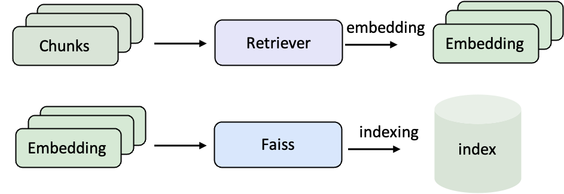
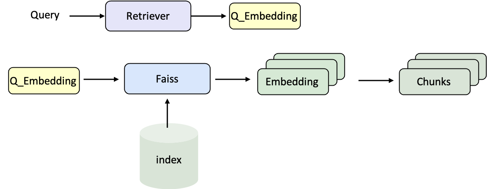

<Note>我们为该 Demo 录制了一期讲解视频：[📺 bilibili](https://www.bilibili.com/video/BV1B9apz4E7K/?share_source=copy_web&vd_source=7035ae721e76c8149fb74ea7a2432710)。</Note>
## 什么是RAG？

> 想象你在参加一次开卷考试。你本人就是大语言模型，具备理解题目和写答案的能力。  
> 但你不可能记住所有知识点。这时，允许你带一本教材或参考书进考场——这就是检索。  
> 当你翻书找到相关内容，再结合自己的理解去写答案，这样答案既准确又有根据。  
> 这就是 RAG —— 检索增强生成。

RAG（Retrieval-Augmented Generation，检索增强生成）是一种让大语言模型（LLM）在“生成”之前，先去“检索”相关文档或知识库，再结合这些信息生成回答的技术。

### 流程

**检索阶段**：根据用户问题，从文档库中找到最相关的内容（比如知识库、网页等）；  


**生成阶段**：把检索到的内容作为上下文，输入给 LLM，让它基于这些信息生成回答  


### 作用

- 提升准确度、降低“幻觉”
- 无需重训模型，也能保持时效性和专业性
- 增强可信度
  

## 语料库编码与索引

在使用 RAG 之前，需要先将原始文档转化为 向量表示，并建立 检索索引。这样，当用户提问时，系统才能在大规模语料库中快速找到最相关的内容。
- **编码（Embedding）**：把自然语言文本转化为向量，让计算机可以用数学方式比较语义相似度。
- **索引（Indexing）**：把这些向量组织起来，比如用 FAISS，这样检索时才能在几百万条文档中瞬间找到最相关的若干条。



### 示例语料（Wiki 文本）

```json data/corpus_example.jsonl icon="/images/json.svg"
{"id": "2066692", "contents": "Truman Sports Complex The Harry S. Truman Sports...."}
{"id": "15106858", "contents": "Arrowhead Stadium 1970s...."}
```

这是典型的 Wiki 语料，其中 id 是文档的唯一标识符，contents 是实际的文本内容。后续我们会对 contents 做向量化并建立索引。

### 编写编码、索引Pipeline

```yaml examples/experiments/corpus_index.yaml icon="/images/yaml.svg"
# MCP Server
servers:
  retriever: servers/retriever

# MCP Client Pipeline
pipeline:
- retriever.retriever_init
- retriever.retriever_embed
- retriever.retriever_index
```
这里定义了一个最小的三步流程：初始化 → 编码 → 建索引。

### 编译Pipeline文件

```shell
ultrarag build examples/experiments/corpus_index.yaml
```

### 修改参数文件

```yaml examples/experiments/parameter/corpus_index_parameter.yaml icon="/images/yaml.svg"
retriever:
  backend: sentence_transformers
  backend_configs:
    bm25:
      lang: en
      save_path: index/bm25
    infinity:
      bettertransformer: false
      model_warmup: false
      pooling_method: auto
      trust_remote_code: true
    openai:
      api_key: abc
      base_url: https://api.openai.com/v1
      model_name: text-embedding-3-small
    sentence_transformers:
      sentence_transformers_encode:
        encode_chunk_size: 256
        normalize_embeddings: false
        psg_prompt_name: document
        psg_task: null
        q_prompt_name: query
        q_task: null
      trust_remote_code: true
  batch_size: 16
  collection_name: wiki
  corpus_path: data/corpus_example.jsonl
  embedding_path: embedding/embedding.npy
  gpu_ids: '1'
  index_backend: faiss
  index_backend_configs:
    faiss:
      index_chunk_size: 10000
      index_path: index/index.index
      index_use_gpu: true
    milvus:
      id_field_name: id
      id_max_length: 64
      index_chunk_size: 1000
      index_params:
        index_type: AUTOINDEX
        metric_type: IP
      metric_type: IP
      search_params:
        metric_type: IP
        params: {}
      text_field_name: contents
      text_max_length: 60000
      token: null
      uri: index/milvus_demo.db
      vector_field_name: vector
  is_demo: false
  is_multimodal: false
  model_name_or_path: openbmb/MiniCPM-Embedding-Light # [!code --]
  model_name_or_path: Qwen/Qwen3-Embedding-0.6B # [!code ++]
  overwrite: false
```

### 运行Pipeline文件

```shell
ultrarag run examples/experiments/corpus_index.yaml
```

编码与索引阶段通常涉及大规模语料处理，耗时较长。建议使用 `screen` 或 `nohup` 将任务挂载至后台运行，例如：

```shell
nohup ultrarag run examples/experiments/corpus_index.yaml > log.txt 2>&1 &
```

运行成功后，就会得到对应的语料向量和索引文件，后续 RAG Pipeline 就可以直接使用它们来完成检索。

## 搭建RAG Pipeline

当语料库的索引准备完成后，下一步就是将 检索器 和 大语言模型（LLM） 组合起来，搭建一个完整的 RAG Pipeline。这样，问题可以经过检索找到相关文档，再交由模型生成最终回答。

### 检索流程



### 生成流程


### 数据格式（以 NQ 数据集为例）

```json data/sample_nq_10.jsonl icon="/images/json.svg"
{"id": 0, "question": "when was the last time anyone was on the moon", "golden_answers": ["14 December 1972 UTC", "December 1972"], "meta_data": {}}
{"id": 1, "question": "who wrote he ain't heavy he's my brother lyrics", "golden_answers": ["Bobby Scott", "Bob Russell"], "meta_data": {}}
{"id": 2, "question": "how many seasons of the bastard executioner are there", "golden_answers": ["one", "one season"], "meta_data": {}}
{"id": 3, "question": "when did the eagles win last super bowl", "golden_answers": ["2017"], "meta_data": {}}
{"id": 4, "question": "who won last year's ncaa women's basketball", "golden_answers": ["South Carolina"], "meta_data": {}}
```
每条样本包含问题、标准答案（golden_answers）和附加信息（meta_data），后续会作为输入与评测基准。

### 编写RAG Pipeline

```yaml examples/demos/rag.yaml icon="/images/yaml.svg"
# MCP Server
servers:
  benchmark: servers/benchmark
  retriever: servers/retriever
  prompt: servers/prompt
  generation: servers/generation
  evaluation: servers/evaluation
  custom: servers/custom

# MCP Client Pipeline
pipeline:
- benchmark.get_data
- retriever.retriever_init
- retriever.retriever_search
- generation.generation_init
- prompt.qa_rag_boxed
- generation.generate
- custom.output_extract_from_boxed
- evaluation.evaluate
```

整个流程依次完成：
1. 读取数据 → 2. 初始化检索器并搜索 → 3. 启动 LLM 服务 → 4. 拼接 Prompt → 5. 生成回答 → 6. 提取结果 → 7. 评测性能。

### 编译 Pipeline 文件

```shell
ultrarag build examples/demos/rag.yaml
```

### 修改参数文件（指定数据集、模型与检索配置）

```yaml examples/experiments/parameter/rag_parameter.yaml icon="/images/yaml.svg"
benchmark:
  benchmark:
    key_map:
      gt_ls: golden_answers
      q_ls: question
    limit: -1
    name: nq
    path: data/sample_nq_10.jsonl
    seed: 42
    shuffle: false
custom: {}
evaluation:
  metrics:
  - acc
  - f1
  - em
  - coverem
  - stringem
  - rouge-1
  - rouge-2
  - rouge-l
  save_path: output/evaluate_results.json
generation:
  backend: vllm
  backend_configs:
    hf:
      batch_size: 8
      gpu_ids: 2,3
      model_name_or_path: openbmb/MiniCPM4-8B
      trust_remote_code: true
    openai:
      api_key: abc
      base_delay: 1.0
      base_url: http://localhost:8000/v1
      concurrency: 8
      model_name: MiniCPM4-8B
      retries: 3
    vllm:
      dtype: auto
      gpu_ids: 2,3
      gpu_memory_utilization: 0.9
      model_name_or_path: openbmb/MiniCPM4-8B  # [!code --]
      model_name_or_path: Qwen/Qwen3-8B # [!code ++]
      trust_remote_code: true
  extra_params:
    chat_template_kwargs:
      enable_thinking: false
  sampling_params:
    max_tokens: 2048
    temperature: 0.7
    top_p: 0.8
  system_prompt: ''
prompt:
  template: prompt/qa_boxed.jinja # [!code --]
  template: prompt/qa_rag_boxed.jinja  # [!code ++]
retriever:
  backend: sentence_transformers
  backend_configs:
    bm25:
      lang: en
      save_path: index/bm25
    infinity:
      bettertransformer: false
      model_warmup: false
      pooling_method: auto
      trust_remote_code: true
    openai:
      api_key: abc
      base_url: https://api.openai.com/v1
      model_name: text-embedding-3-small
    sentence_transformers:
      sentence_transformers_encode:
        encode_chunk_size: 256
        normalize_embeddings: false
        psg_prompt_name: document
        psg_task: null
        q_prompt_name: query
        q_task: null
      trust_remote_code: true
  batch_size: 16
  collection_name: wiki
  corpus_path: data/corpus_example.jsonl
  gpu_ids: '1'
  index_backend: faiss
  index_backend_configs:
    faiss:
      index_chunk_size: 10000
      index_path: index/index.index
      index_use_gpu: true
    milvus:
      id_field_name: id
      id_max_length: 64
      index_chunk_size: 1000
      index_params:
        index_type: AUTOINDEX
        metric_type: IP
      metric_type: IP
      search_params:
        metric_type: IP
        params: {}
      text_field_name: contents
      text_max_length: 60000
      token: null
      uri: index/milvus_demo.db
      vector_field_name: vector
  is_demo: false
  is_multimodal: false
  model_name_or_path: openbmb/MiniCPM-Embedding-Light  # [!code --]
  model_name_or_path: Qwen/Qwen3-Embedding-0.6B  # [!code ++]
  query_instruction: ''
  top_k: 5
```

### 运行Pipeline文件

```shell
ultrarag run examples/demos/rag.yaml
```

### 查看生成结果

使用可视化脚本快速浏览模型输出

```shell
python ./script/case_study.py \
  --data output/memory_nq_rag_full_20251010_145420.json \
  --host 127.0.0.1 \
  --port 8080 \
  --title "Case Study Viewer"
```
