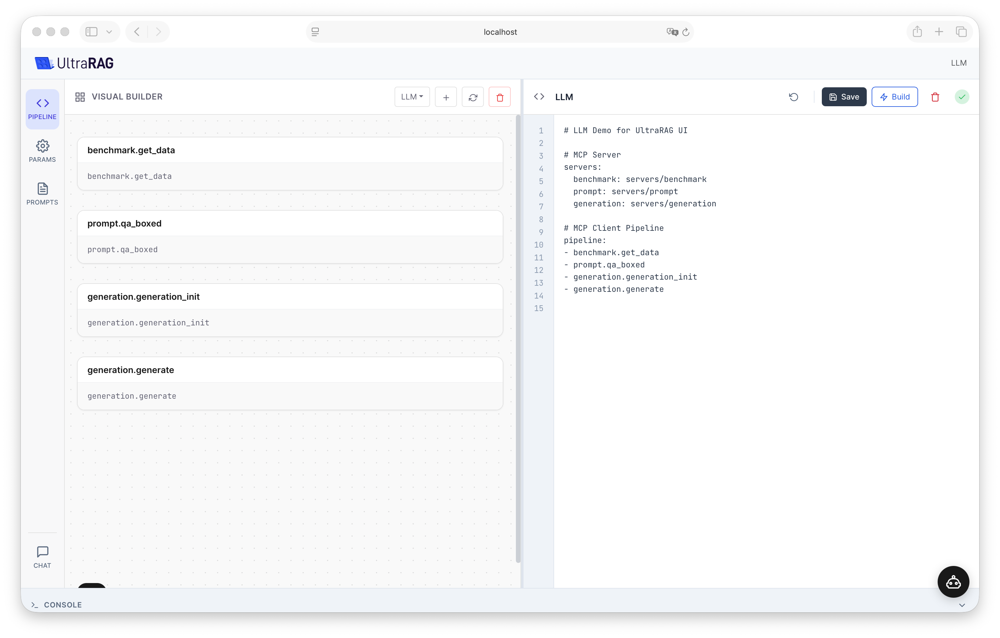
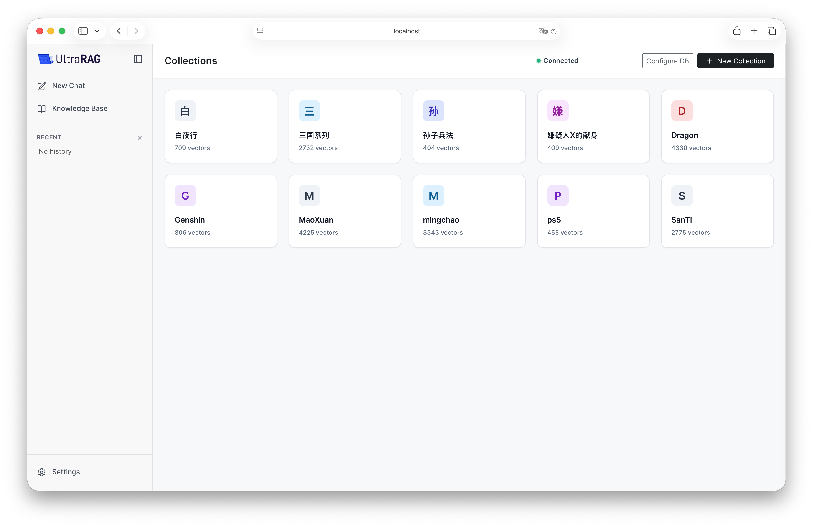

UltraRAG UI 包含聊天、知识库和流程搭建器。以下命令在仓库根目录执行，并使用项目虚拟环境。

## 启动界面

```bash
# 本地执行：本地服务器无需 MCP 传输依赖
uv sync
source .venv/bin/activate
ultrarag show ui --no-mcp --host 127.0.0.1 --port 5050
```

打开 `http://127.0.0.1:5050`。根据流程实际使用的服务器安装额外依赖，例如 `uv sync --extra generation --extra retriever`。

使用 MCP 传输时，安装 `uv sync --extra mcp`，并省略 `--no-mcp`。本地模式中混用远程 MCP 条目仍需 MCP extra 和 Node.js 20 以上。两种模式共用 YAML 格式和生成的参数文件。

<Note>搭建器的编辑操作和助手工作区工具需要管理员账号，请在提示时登录。CLI 没有 `--admin` 参数。本机使用时保留默认的回环地址。</Note>

## 新建并构建流程

1. 打开 **搭建器 → 新建流程**，输入以字母或下划线开头的唯一名称并确认。新草稿会立即选中，Build 前也会保留在列表中。
2. 编辑 YAML，或通过画布节点菜单添加步骤。检查服务器声明、步骤顺序、输入输出重映射、循环与分支。
3. 点击 **保存** 保留草稿，或点击 **Build** 保存当前 YAML 并生成参数。在控制台查看结果；失败后可直接修改草稿重试。
4. 在 **参数** 面板配置模型地址、模型名称和凭据并保存。可在 Prompt 管理中创建、编辑、重命名或删除 Jinja 模板。
5. 已构建的流程可在聊天页选择。发送测试问题，检查回答和来源；用停止按钮取消前台响应。耗时流程可以使用后台任务控制。

<Warning>修改流程 YAML 后，原来的服务器元数据会失效，需要重新 Build。Build 成功表示配置生成完成，仍需测试模型、嵌入和数据库服务能否正常调用。</Warning>



## 查看终端输出

控制台展示构建开始、后端构建日志、成功或失败结果，以及助手工具进度。点击标题或用 Enter、空格键展开和收起。长行自动换行，输出区域可独立滚动；Build 后保留展开状态，便于核对结果。

## 配置知识库

进入知识库，配置向量数据库，再创建集合并上传文档。在索引前配置分块策略和嵌入模型地址。数据库部署见[准备环境](/pages/cn/ui/prepare)。

默认处理配置位于 `examples/demos/parameter/`，包括 `corpus_chunk_parameter.yaml` 和索引流程参数。聊天流程应使用相同的集合及嵌入模型。



## 使用流程助手

在助手设置中填写 API 地址、密钥和模型，先测试连接。兼容 OpenAI 的服务支持工作区工具循环。[Agent 助手指南](/pages/cn/ui/assistant)介绍工具检查、方案审阅和流程测试。
