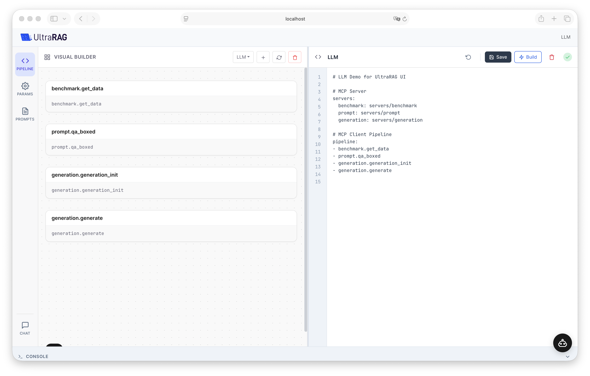
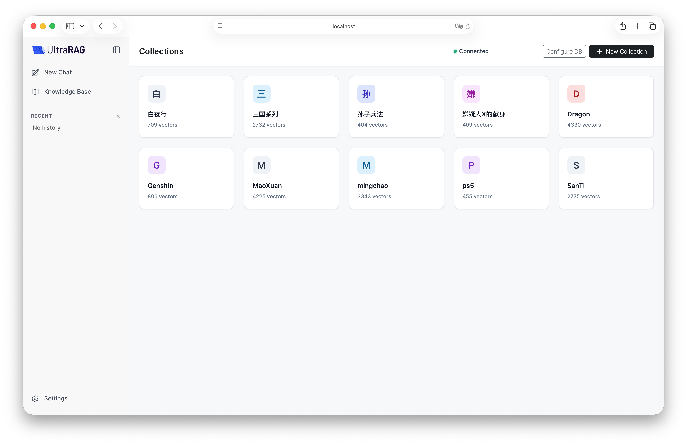

UltraRAG UI includes Chat, Knowledge Base and Pipeline Builder. Run commands from the repository root with the virtual environment activated.

## Start the UI

```bash
# Local execution: no MCP transport required for local servers
uv sync
source .venv/bin/activate
ultrarag show ui --no-mcp --host 127.0.0.1 --port 5050
```

Open `http://127.0.0.1:5050`. Install the extras required by the servers you use, for example `uv sync --extra generation --extra retriever`.

For MCP transport, install `uv sync --extra mcp` and omit `--no-mcp`. Remote MCP entries still require the MCP extra and Node.js 20 or newer in local mode. The YAML format and generated parameters are shared between both modes.

<Note>Builder edits and workspace assistant tools require an administrator account. Sign in when prompted. The CLI has no `--admin` option. Keep the default loopback host for a local session.</Note>

## Create and build a pipeline

1. Open **Builder → New Pipeline**, enter a unique name starting with a letter or underscore, and confirm. The new draft is selected immediately and remains listed before Build.
2. Edit YAML or use the canvas node menu. Inspect the declared servers, step order, input/output remapping, loops and branches.
3. Click **Save** to save a draft, or **Build** to save the current YAML and generate parameters. Review the console for the result; an error leaves the draft available for correction.
4. Open **Parameters**, configure the model endpoint, model name and credentials, and save. Use Prompt management to create, edit, rename or delete Jinja templates.
5. A built pipeline is available in Chat. Send a test question and inspect its answer and sources. Use Stop to cancel a foreground response. Long-running pipelines can use the background task controls.

<Warning>Changing pipeline YAML invalidates its generated server metadata. Build again before running. A successful Build checks configuration generation; it does not prove that model, embedding or database services are reachable.</Warning>



## Read the console

The console shows the build start, backend build logs, success or failure, and assistant tool progress. Expand or collapse it with a click, Enter or Space. Long lines wrap and the output scrolls independently. Build keeps the console visible so you can inspect the result.

## Configure a knowledge base

Open Knowledge Base, configure the vector database, then create a collection and upload documents. Configure chunking and the embedding endpoint before indexing. See [database preparation](/pages/en/ui/prepare).

Default processing configurations live under `examples/demos/parameter/`, including `corpus_chunk_parameter.yaml` and the index pipeline parameters. Choose a chat pipeline that uses the same collection and embedding model.



## Use the pipeline assistant

Configure an API endpoint, API key and a model in the assistant settings, then test the connection. OpenAI-compatible providers support the workspace tool loop. Follow the [agent assistant guide](/pages/en/ui/assistant) for inspecting tools, reviewing proposals and testing a pipeline.
